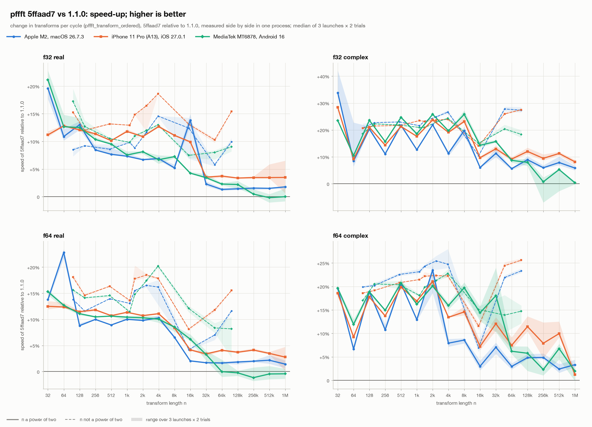
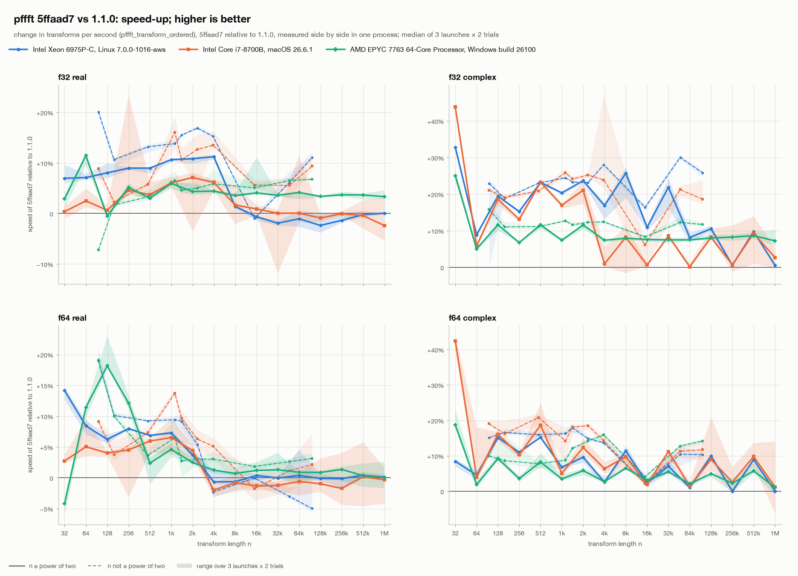
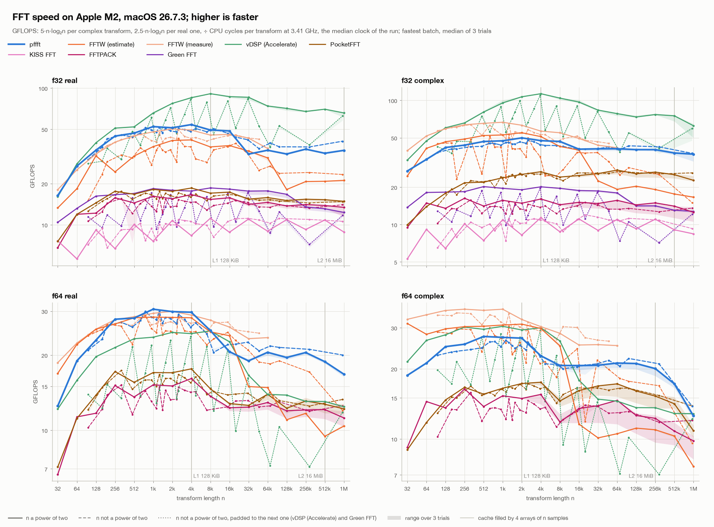
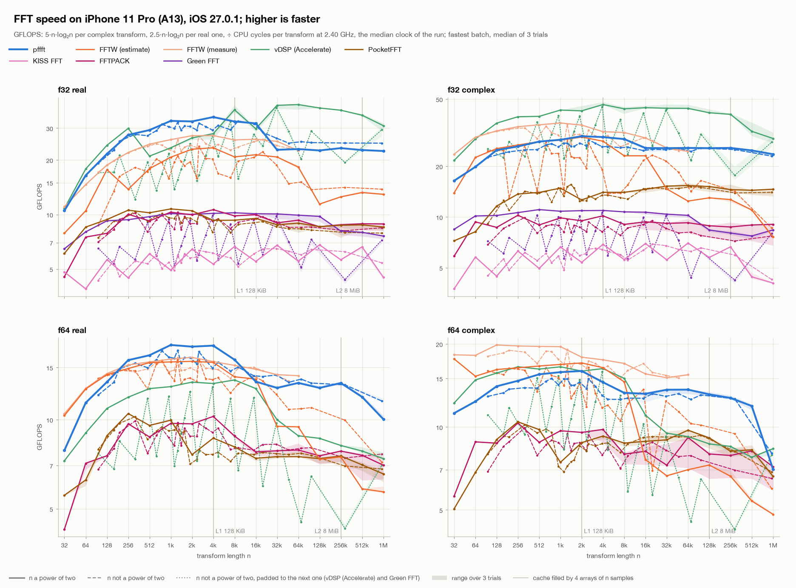
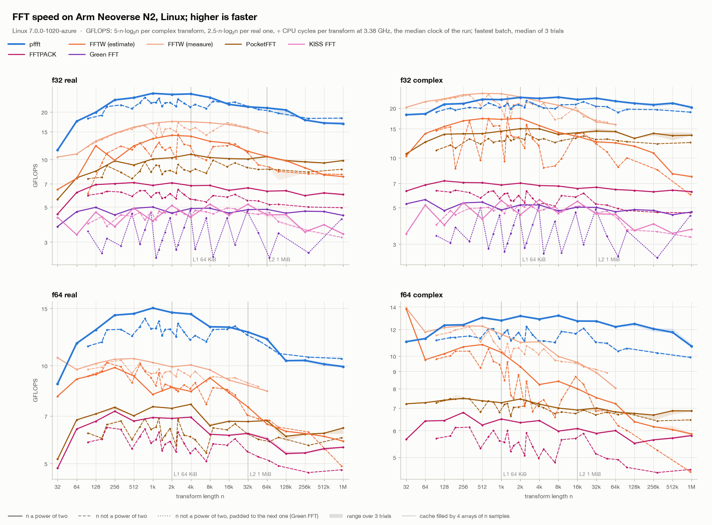
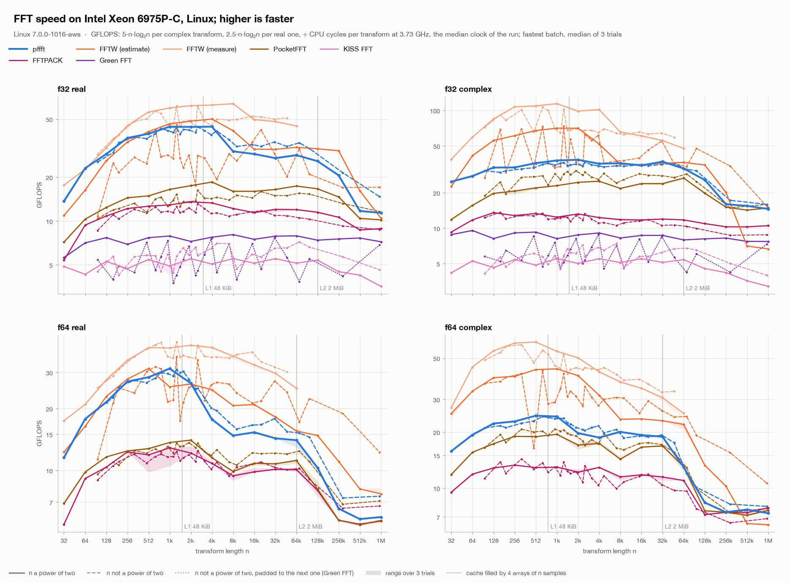
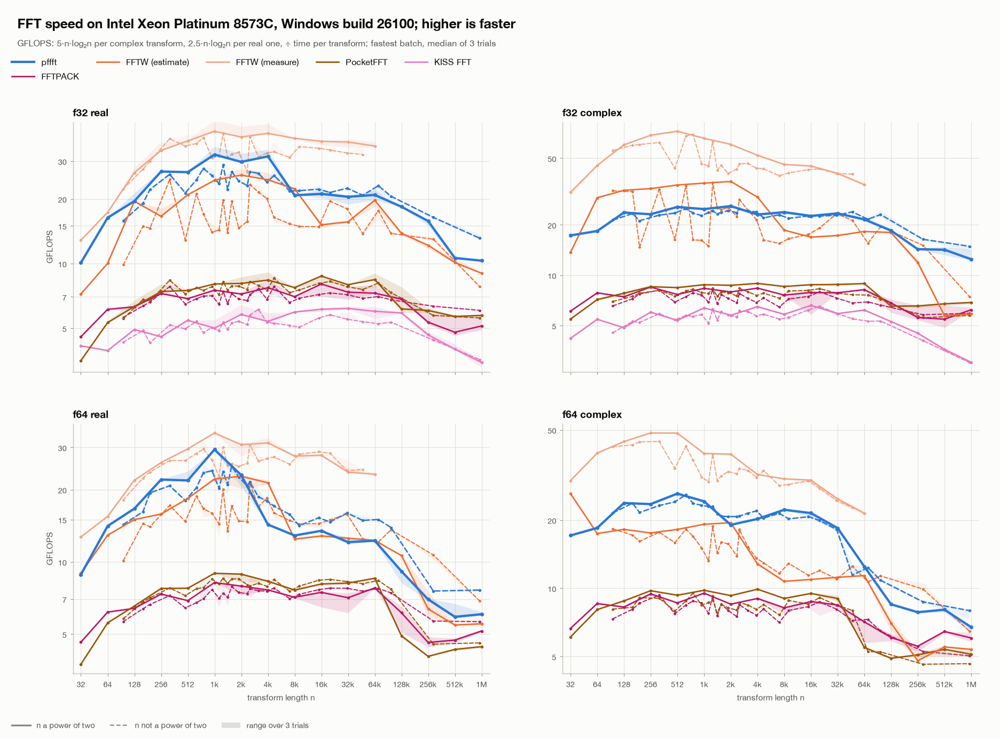
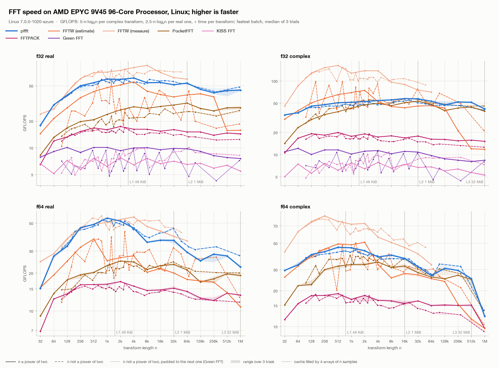
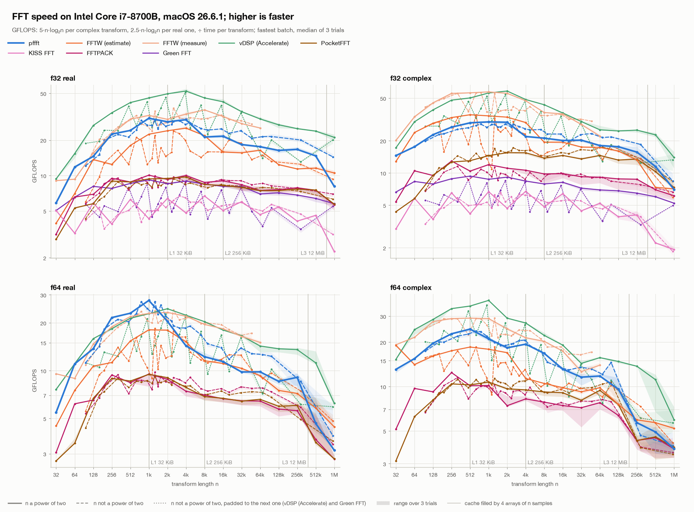

# pffft benchmark results

Measured with [bench_fft](../benchmarks/README.md) in November 2026: pffft
(commit 5ffaad7) against the FFT libraries it is usually compared with, on
nine machines, and against pffft 1.1.0, which is as fast as Julien
Pommier's original, on six. Every chart has a panel per precision (f32, f64)
and transform kind (real, complex) and covers 44 lengths from 32 to 2^20:
the powers of two and 28 other lengths with factors 3 and 5.

## Summary

pffft's speed relative to each library: the geometric mean over the 176
cases of a machine (2 precisions × 2 kinds × 44 lengths) of the other
library's time over pffft's. Above 1, pffft is faster; "-" means the library
is not available there.

| Machine | FFTW (measure) | FFTW (estimate) | vDSP | PocketFFT | KISS FFT | FFTPACK | Green FFT |
|---|---|---|---|---|---|---|---|
| Apple M2, macOS | 0.88 | 1.20 | 0.82 | 1.85 | 4.43 | 2.33 | 2.40 |
| iPhone 11 Pro (A13), iOS | 0.95 | 1.29 | 0.95 | 1.99 | 4.59 | 2.23 | 2.64 |
| MediaTek MT6878, Android | 1.12 | 1.41 | - | 2.01 | 4.32 | 2.24 | 2.08 |
| Arm Neoverse N2, Linux | 1.22 | 1.65 | - | 1.87 | 4.71 | 2.71 | 4.37 |
| Microsoft Cobalt 100 (Neoverse N2), Windows | - | - | - | 2.34 | 4.06 | 2.50 | - |
| Intel Xeon 6975P-C, Linux | 0.57 | 0.87 | - | 1.55 | 5.75 | 2.18 | 3.45 |
| Intel Xeon Platinum 8573C, Windows | 0.62 | 1.22 | - | 2.54 | 4.12 | 2.65 | - |
| AMD EPYC 9V45, Linux | 0.68 | 1.34 | - | 1.54 | 6.73 | 2.83 | 4.90 |
| Intel Core i7-8700B, macOS (VM) | 0.78 | 1.30 | 0.63 | 2.03 | 4.38 | 2.20 | 2.43 |

KISS FFT and Green FFT are measured in single precision only.

- **Portable libraries.** pffft was faster than PocketFFT, KISS FFT, FFTPACK
  and Green FFT in 1554 of the 1584 cases. 21 of the 30 exceptions are on
  the AMD EPYC 9V45, all against PocketFFT and all complex: 18 single
  precision lengths that are not powers of two, from 960 to 1000000, where
  pffft was up to 14.4% slower, and 3 double precision ones, up to 3.3%. The
  other 9 are complex transforms out of cache, at n of 65536 and more (5 on
  the Xeon 6975P-C, 2 on the Core i7-8700B, 1 each on the M2 and the
  iPhone), where pffft was at most 7.6% slower.
- **FFTW** plans a transform in one of several modes; two are measured here.
  `FFTW_ESTIMATE` plans at once, as pffft and the other libraries do.
  `FFTW_MEASURE` times candidate algorithms on the machine and keeps the
  fastest, which takes up to a few seconds per length. The benchmark leaves
  that planning time out, so the comparison favours `FFTW_MEASURE`: in an
  application its cost pays off only over many transforms of one length.
  - *Real transforms.* pffft was faster than `FFTW_ESTIMATE` on every
    machine (geometric means from 1.02 on the Xeon 6975P-C to 1.74 on the
    Neoverse N2). On arm64 it was also faster than `FFTW_MEASURE` on the
    iPhone, the MediaTek phone and the Neoverse N2 (1.10, 1.27 and 1.39)
    and level with it on the M2 (1.00).
  - *Complex transforms.* pffft was faster than `FFTW_ESTIMATE` everywhere
    but on the Xeon 6975P-C (1.07 to 1.56; 0.73 there). `FFTW_MEASURE` was
    faster on Apple's chips (pffft 0.77 and 0.83), level with pffft on the
    MediaTek phone (1.00) and slower on the Neoverse N2 (1.06).
  - *x86.* `FFTW_MEASURE` was faster on the x86 machines (pffft 0.57 to
    0.78 over all cases): FFTW has AVX2 and AVX-512 code, while pffft's
    single precision uses 4-wide SSE there (its double precision uses AVX).
- **vDSP**, Apple's FFT, was faster in single precision. On Apple's chips it
  hands single-precision FFTs from n = 256 or 512 to the AMX matrix unit, a
  coprocessor that the cores of a cluster share: one thread at a time
  benefits, while pffft's NEON code runs on every core. While AMX works, the
  chip lowers its clock, by 7.7% on the M2 and up to 25% on the iPhone 11
  Pro, for as long as AMX is busy; bench_fft charges vDSP for that (see
  [How it was measured](#how-it-was-measured)). In double precision, where
  vDSP did not lower the clock, pffft was faster on Apple's chips
  (geometric means 1.03 to 1.32 per kind) and slower on the Intel Mac
  (0.73 real, 0.65 complex).

## Performance improvements since Pommier's pffft



pffft 1.1.0 (here commit c14802c) predates the performance work of this
fork. Its single-precision FFT is Julien Pommier's original code, so its
speed is the speed of Pommier's pffft (which has no double precision). Since
then pffft has gained, among others, fused multiply-adds (NEON and x86 FMA),
NEON double precision with native intrinsics instead of an emulation, faster
NEON transposes, fast paths in the radix-3 and radix-4 real butterflies,
code layout that keeps the radix-3 and radix-5 real kernels out of line, a
radix-8 last pass for the complex lengths whose n/4 has an odd power of two,
and complex butterflies that get the direction of the transform as a
constant.

Both versions run in one process and take turns, batch by batch
(benchmarks/compare.py). Averaged over the lengths, the current pffft was 16
to 17% faster below n = 4096 (16.0% on the M2, 16.8% on the iPhone, 16.3% on
the MediaTek phone) and 7.5 to 10.5% faster from 4096 up (7.5%, 10.5% and
8.2%), up to 34% at single lengths (complex n = 32 on the M2). In cache (n up
to 16384) it was faster at every length, by 2% at least; out of cache the
gain shrinks, and on the MediaTek phone a few real lengths from 2^16 up are
within the noise (1.2% slower at most).



On x86 the gain is smaller, as much of the work above was for NEON; what
applies there is FMA (where the build targets AVX2 or newer), the radix-3
and radix-4 fast paths, the code layout, the radix-8 pass and the constant
direction. Below n = 4096, pffft was 13.8% faster on the Xeon 6975P-C
(Linux, gcc), 12.8% on the Core i7-8700B (macOS, Clang) and 7.9% on the EPYC
7763 (Windows, MSVC); from 4096 up 5.4%, 3.8% and 4.9%. The largest gains
are at complex n = 32: in single precision 33% on the Xeon, 44% on the Core
i7 and 25% on the EPYC. No complex length was slower (in a second run on the
Xeon, one by 0.2%, within the noise). Some real lengths were slower: on the
Xeon and the Core i7 several from n = 4000 up, by 2.3% at most in cache and
5.0% out of cache; on the EPYC f32 n = 96 by 7.2% and f64 n = 32 by 4.2%.
The averages of two runs of this comparison on the Xeon 6975P-C, on
different hosts, differed by less than 0.1%, single lengths by 0.25% on
average.

## Machines

How to read the charts: each shows one machine, with the speed in GFLOPS on
a log scale (higher is faster) over the transform length n.

- **Solid lines** are the powers of two.
- **Dashed lines** are the other lengths, which the library transforms as
  they are.
- **Dotted lines** are the other lengths for a library that only does powers
  of two (vDSP, Green FFT): the flops of n in the time of the next power of
  two, as if the input were padded with zeros to it.
- **Bands** around a line show the range over the 3 trials.
- **Grey vertical lines** mark the lengths at which four arrays of n
  samples, about the working set of a transform, fill the L1 and L2 caches
  (and L3, where the system reports one).

Where cycles were counted, the subtitle gives the clock at which they were
converted to time.

### Apple M2, macOS


### iPhone 11 Pro (A13), iOS


### MediaTek MT6878, Android


### Arm Neoverse N2, Linux (GitHub runner)


### Microsoft Cobalt 100, Windows (GitHub runner)
FFTW is left out: its CMake build, the one Windows can use, has no NEON.
Green FFT crashes on Windows.


### Intel Xeon 6975P-C, Linux (GitHub runner)


### Intel Xeon Platinum 8573C, Windows (GitHub runner)
FFTW is built with its CMake build here, with AVX2: that build has no
AVX-512 code, while pffft and the other libraries were built with
/arch:AVX512.



### AMD EPYC 9V45, Linux (GitHub runner)
This runner exposes no cycle counter, so the chart is in measured time.



### Intel Core i7-8700B, macOS (GitHub runner, VM)


## How it was measured

- **Speed** is in GFLOPS, counting 5·n·log2(n) flops per complex transform
  and 2.5·n·log2(n) per real one (benchFFT's convention), for one transform:
  half a forward and backward pair, out of place, ordered output
  (pffft_transform_ordered). It is the fastest of many short batches,
  median of 3 trials.
- **Time.** Where the system lets a program count its CPU cycles (the M2,
  the iPhone, the MediaTek phone, the Neoverse N2 and the Xeon 6975P-C), a
  transform's time is its cycles at the median clock of the run, which
  keeps the clock's noise out. Elsewhere (Windows, macOS virtual machines,
  the EPYC 9V45) it is the measured time.
- **Clock.** Cycles are fair only if every library runs at the same clock.
  bench_fft compares the clock of each batch with that of the neighbouring
  batches of the other libraries; a library that lowers the clock by more
  than 2%, such as vDSP through AMX, is charged for the cycles it costs the
  others: its count is divided by the ratio of the clocks.
  [benchmarks/README.md](../benchmarks/README.md) explains the method and
  its limits.
- **Builds.** Every library was compiled from source with the same flags,
  the best for the CPU: -march=native with Clang and GCC (the M2, the Linux
  and macOS runners), /arch:AVX512 with MSVC on the Xeon Platinum 8573C
  (/arch:AVX2 on the EPYC 7763 of the comparison with 1.1.0), MSVC's default
  on the Cobalt 100. The phones were built with their toolchain's defaults
  (NEON). FFTW 3.3.10 was built with its SIMD code (NEON, AVX, AVX2, AVX-512
  where the CPU has it), except on Windows, where its CMake build has AVX2
  at most and no NEON (hence no FFTW on the Cobalt 100). vDSP is the
  system's Accelerate.
- **Versions.** pffft is commit 5ffaad7, measured as commits 677d4ae and
  3de6600, which have the same code (the CSV headers name those); 1.1.0 is
  commit c14802c. The phones and the M2 ran the benchmark locally; the other
  machines are GitHub-hosted runners (shared virtual machines), measured by
  .github/workflows/bench.yml, the comparisons on x86 with its `compare`
  input set to `c14802c 3de6600`. GitHub's ubuntu-26.04 label lands on Intel
  and AMD CPUs, some without a cycle counter; its runs were repeated until
  one ran on the Xeon 6975P-C with one.

To repeat a measurement:

```sh
python3 benchmarks/run.py --fftw -o local.csv            # this computer
python3 benchmarks/compare.py c14802c master -o cmp.csv  # two revisions
uv run --with matplotlib python3 benchmarks/plot.py local.csv -o local.png
```
