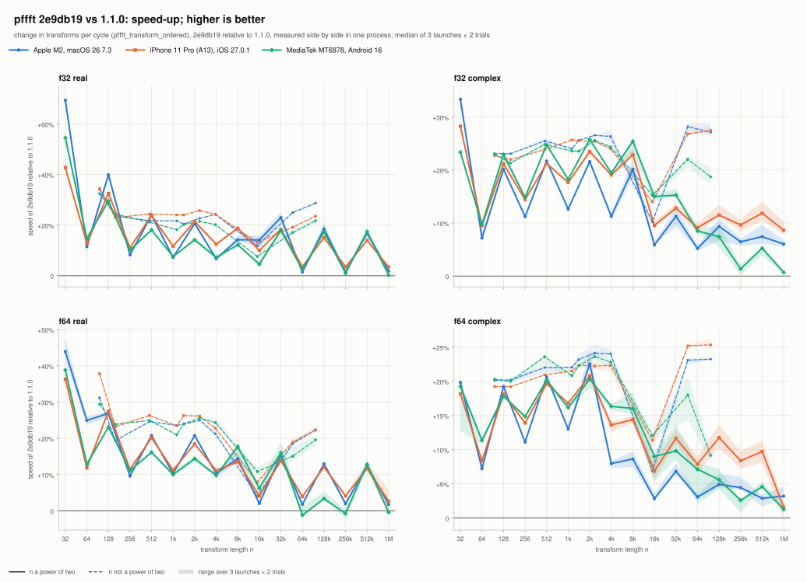
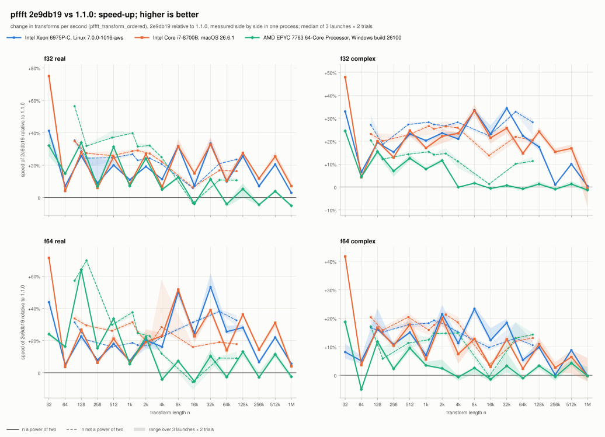
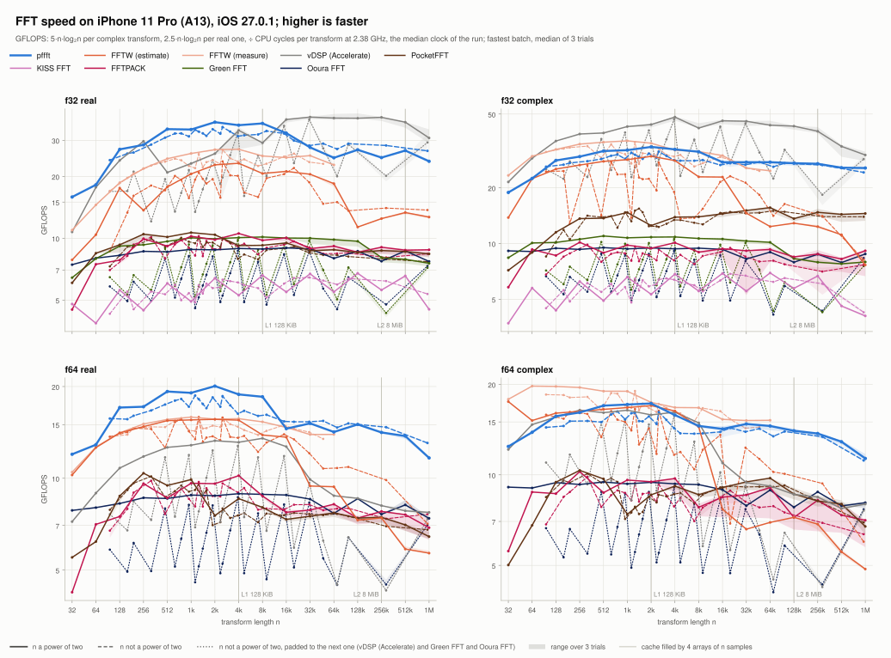
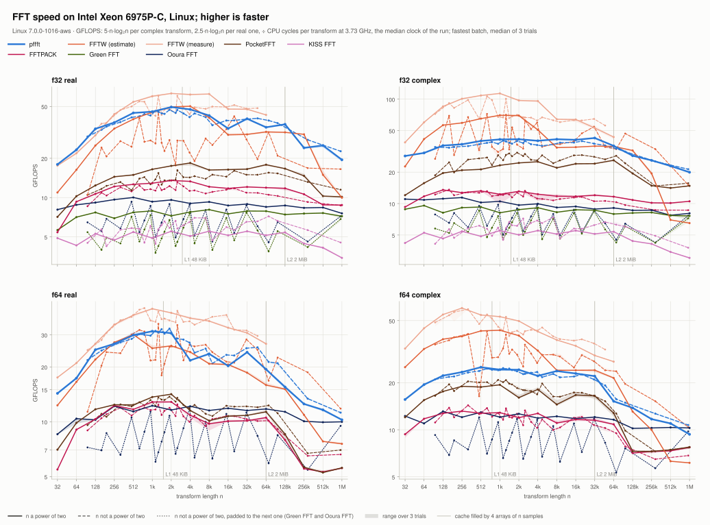

# pffft benchmark results

Measured with [bench_fft](../benchmarks/README.md) in November 2026: pffft
(commit 2c03a16) against the FFT libraries it is usually compared with, on
nine machines, and against pffft 1.1.0, which is as fast as Julien
Pommier's original, on six. Every chart has a panel per precision (f32,
f64) and transform kind (real, complex). The charts per machine cover 44
lengths from 32 to 2^20: the powers of two and 28 other lengths with
factors 3 and 5. The comparisons with 1.1.0 cover 45 lengths from 32 to
2^22: the powers of two and 27 others, 11 of them from 192000 up.

## Summary

pffft's speed relative to each library: the geometric mean over the 176
cases of a machine (2 precisions × 2 kinds × 44 lengths) of the other
library's time over pffft's. Above 1, pffft is faster; "-" means the library
is not available there.

| Machine | FFTW (measure) | FFTW (estimate) | vDSP | PocketFFT | KISS FFT | FFTPACK | Green FFT | Ooura's FFT |
|---|---|---|---|---|---|---|---|---|
| Apple M2, macOS | 1.00 | 1.36 | 0.93 | 2.09 | 4.98 | 2.63 | 2.71 | 2.18 |
| iPhone 11 Pro (A13), iOS | 1.05 | 1.43 | 1.08 | 2.22 | 5.05 | 2.47 | 2.94 | 2.36 |
| MediaTek MT6878, Android | 1.21 | 1.58 | - | 2.25 | 4.87 | 2.49 | 2.41 | 2.00 |
| Arm Neoverse N2, Linux | 1.29 | 1.75 | - | 1.98 | 5.05 | 2.87 | 4.68 | 2.33 |
| Microsoft Cobalt 100 (Neoverse N2), Windows | - | - | - | 2.48 | 4.43 | 2.65 | - | 2.18 |
| Intel Xeon 6975P-C, Linux | 0.65 | 1.05 | - | 1.84 | 6.71 | 2.59 | 4.27 | 2.51 |
| Intel Xeon Platinum 8573C, Windows | 0.71 | 1.45 | - | 2.99 | 4.76 | 3.11 | - | 2.05 |
| AMD EPYC 9V45, Linux | 0.73 | 1.44 | - | 1.67 | 7.32 | 3.05 | 5.25 | 2.95 |
| Intel Core i7-8700B, macOS (VM) | 0.89 | 1.52 | 0.79 | 2.35 | 5.08 | 2.56 | 3.07 | 1.64 |

KISS FFT and Green FFT are measured in single precision only. vDSP, Green
FFT and Ooura's FFT do only powers of two, and `FFTW_MEASURE` runs only up
to n = 65536, so their means are over those cases (on the Cobalt 100,
Ooura's FFT has no single-precision real n = 32).

- **Portable libraries.** pffft was faster than PocketFFT, KISS FFT,
  FFTPACK, Green FFT and Ooura's FFT in 4739 of the 4759 cases.
  - *Ooura's FFT*, 11 of the 20 exceptions, all but two in double
    precision from n = 2^18 up: on the Core i7 complex 2^18 to 2^20 (3.9 to
    10%) and real 2^18 to 2^20 (3.5 to 27%), on the Xeon 6975P-C complex
    2^20 (1.6%), on the MediaTek phone real 2^18 and 2^19 (23% and 2.7%);
    and real n = 32 on the Core i7 (11% in double and 2.9% in single
    precision). Ooura's FFT works in place, so out of cache it moves less data
    than pffft's ordered transform out of place. On the M2, the iPhone, the
    Neoverse N2 and the Cobalt 100, where pffft had fallen behind at 2^20 or
    come close, it was 1.3 to 1.9 times as fast in double precision from
    2^18 to 2^20 (complex 2^20 on the M2: 1.41), and on the MediaTek phone,
    where it had lost by up to 57%, 1.08 to 1.39 times at complex 2^18 to
    2^20 and real 2^20.
  - *PocketFFT*: 9 cases on the AMD EPYC 9V45, all single precision
    complex lengths that are not powers of two, from 1440 to 1000000,
    where pffft was up to 7.2% slower.
- **FFTW** plans a transform in one of several modes; two are measured here.
  `FFTW_ESTIMATE` plans at once, as pffft and the other libraries do.
  `FFTW_MEASURE` times candidate algorithms on the machine and keeps the
  fastest, which takes up to a few seconds per length. The benchmark leaves
  that planning time out, so the comparison favours `FFTW_MEASURE`: in an
  application its cost pays off only over many transforms of one length.
  - *Real transforms.* pffft was faster than `FFTW_ESTIMATE` on every
    machine (geometric means from 1.26 on the Xeon 6975P-C to 1.87 on the
    Neoverse N2), faster than `FFTW_MEASURE` on every arm64 machine (1.14
    on the M2, 1.22 on the iPhone, 1.39 on the MediaTek phone and 1.48 on
    the Neoverse N2) and slightly faster on the Core i7 (1.03).
  - *Complex transforms.* pffft was faster than `FFTW_ESTIMATE` everywhere
    but on the Xeon 6975P-C (1.16 to 1.65; 0.87 there). `FFTW_MEASURE` was
    faster on Apple's chips (pffft 0.87 and 0.91) and slower on the MediaTek
    phone (1.06) and the Neoverse N2 (1.13).
  - *x86.* `FFTW_MEASURE` was faster on the x86 machines (pffft 0.65 to
    0.89 over all its cases): FFTW has AVX2 and AVX-512 code, while pffft's
    single precision uses 4-wide SSE there (its double precision uses AVX).
- **vDSP**, Apple's FFT, was faster in single precision. On Apple's chips it
  hands single-precision FFTs to the AMX matrix unit, a coprocessor that
  the cores of a cluster share: one thread at a time benefits, while
  pffft's NEON code runs on every core. While AMX works, the chip can lower
  its clock: on the M2 by 7.2 to 8.0% for every single-precision FFT from
  n = 256 (complex) or 512 (real) to 131072 and by 4.7 to 7.3% above, on
  the iPhone 11 Pro by 23 to 25%, for real FFTs of n = 512 to 8192.
  bench_fft charges vDSP for that (see
  [How it was measured](#how-it-was-measured)). In double precision, where
  vDSP lowered the clock hardly more than the other libraries, pffft was faster
  on Apple's chips (geometric means 1.15 to 1.52 per kind) and slower on
  the Intel Mac (0.94 real, 0.78 complex).

## Performance improvements since Pommier's pffft



pffft 1.1.0 (here commit c14802c) predates the performance work of this
fork. Its single-precision FFT is Julien Pommier's original code, so its
speed is the speed of Pommier's pffft (which has no double precision). Since
then pffft has gained, among others, fused multiply-adds (NEON and x86 FMA),
NEON double precision with native intrinsics instead of an emulation, faster
NEON transposes, fast paths in the radix-3 and radix-4 real butterflies,
code layout that keeps the radix-3 and radix-5 real kernels out of line,
one pass fewer for the real and complex lengths whose n/4 has an odd power
of two (a radix-8 or radix-6 last pass in place of the radix-2 one), complex
butterflies that get the direction of the transform as a constant, the
reordering of the ordered transforms in the same sweep as their last or
first step, long transforms split into blocks that are transformed while
they are in cache (`PFFFT_SPLIT_MAX` in the README) with the sweeps
before and after them fused into their first and last steps, and, on x86,
prefetching of the output of the passes out of L1.

Both versions run in one process and take turns, batch by batch
(benchmarks/compare.py). Averaged over the 45 lengths, the current pffft
was 27 to 34% faster below n = 4096 (34.0% on the M2, 33.0% on the
iPhone, 27.5% on the MediaTek phone) and 28 to 32% faster from 4096 up
(28.0%, 31.4% and 31.7%), 36 to 58% above 2^20, and up to 85% at single
lengths (double-precision real n = 3145728 on the iPhone; 78% at
single-precision real n = 32 on the M2). It was faster at every length, by
7.9% at least on Apple's chips and 4.9% on the phone. Over the 26 lengths
this page compared before (the powers of two to 2^20 and 10 others), the
gain from 4096 up went from 11.0% to 21.6% on the M2, from 12.8% to 22.4%
on the iPhone and from 10.5% to 27.4% on the phone, below 4096 from 22.3%
to 34.0%, from 21.9% to 33.0% and from 21.2% to 27.5%.



On x86 the work above for NEON doesn't apply; what does is FMA (where the
build targets AVX2 or newer), the radix-3 and radix-4 fast paths, the code
layout, the pass fewer, the constant direction, the reordering, the
splitting and the output prefetching. On the Intel machines pffft was
faster than 1.1.0 at every length, by 1.4% at least (double-precision real
n = 64 on the Core i7): below n = 4096 by 24.7% on the Xeon 6975P-C
(Linux, gcc) and 26.3% on the Core i7-8700B (macOS, Clang), from 4096 up
by 51.7% and 41.8%. The largest gains are out of cache, where the
splitting works: up to 114% on the Xeon (single-precision real
n = 524288; double-precision real lengths of 2^18 to 2^19 by 92 to 111%)
and 89% on the Core i7 (single-precision real 2^21).

The AMD EPYC 7763 (Windows, MSVC) is the case the README warns about: MSVC
cannot tell AMD from Intel, so the default build prefetches there and
splits arrays from 1 MiB on, as for Intel, which costs Zen at arrays
of 2 to 12 MiB, which 8 MiB would leave whole or split into larger blocks.
pffft was 24.2% faster than 1.1.0 below n = 4096 and 11.5% from 4096 up.
It was slower in 17 cases, by up to 6.9%: at n = 64 (single-precision real
5.2%, double-precision complex 4.0%), at real lengths of 4096 to 16384,
where it prefetches, and at real arrays of 2 to 12 MiB (lengths from
262144 to 3145728), where it splits. The README recommends
`PFFFT_PREFETCH_DIST=0` and `PFFFT_SPLIT_MAX=8388608` for AMD CPUs. In
earlier measurements on this machine, the first made an earlier version
of this code 8.6% and 4.8% faster than 1.1.0 instead of 6.4% and 0.1%
slower (pull request #129); the second made transforms of 65536 to 2^22
points up to 13.5% faster than splitting from 1 MiB on, and none slower
by more than 3.1%.

## Machines

How to read the charts: each shows one machine, with the speed in GFLOPS on
a log scale (higher is faster) over the transform length n.

- **Solid lines** are the powers of two.
- **Dashed lines** are the other lengths, which the library transforms as
  they are.
- **Dotted lines** are the other lengths for a library that only does powers
  of two (vDSP, Green FFT, Ooura's FFT): the flops of n in the time of the
  next power of two, as if the input were padded with zeros to it.
- **Bands** around a line show the range over the 3 trials.
- **Grey vertical lines** mark the lengths at which four arrays of n
  samples, about the working set of a transform, fill the L1 and L2 caches
  (and L3, where the system reports one).

Where cycles were counted, the subtitle gives the clock at which they were
converted to time.

### Apple M2, macOS


### iPhone 11 Pro (A13), iOS


### MediaTek MT6878, Android


### Arm Neoverse N2, Linux (GitHub runner)


### Microsoft Cobalt 100, Windows (GitHub runner)
FFTW is left out: its CMake build, the one Windows can use, has no NEON.
Green FFT crashes on Windows.


### Intel Xeon 6975P-C, Linux (GitHub runner)


### Intel Xeon Platinum 8573C, Windows (GitHub runner)
FFTW is built with its CMake build here, with AVX2: that build has no
AVX-512 code, while pffft and the other libraries were built with
/arch:AVX512.


### AMD EPYC 9V45, Linux (GitHub runner)
This runner exposes no cycle counter, so the chart is in measured time.


### Intel Core i7-8700B, macOS (GitHub runner, VM)


## How it was measured

- **Speed** is in GFLOPS, counting 5·n·log2(n) flops per complex transform
  and 2.5·n·log2(n) per real one (benchFFT's convention), for one transform:
  half a forward and backward pair, out of place, ordered output
  (pffft_transform_ordered). It is the fastest of many short batches,
  median of 3 trials.
- **Time.** Where the system lets a program count its CPU cycles (the M2,
  the iPhone, the MediaTek phone, the Neoverse N2 and the Xeon 6975P-C), a
  transform's time is its cycles at the median clock of the run, which
  keeps the clock's noise out. Elsewhere (Windows, macOS virtual machines,
  the EPYC 9V45) it is the measured time.
- **Clock.** Cycles are fair only if every library runs at the same clock.
  bench_fft compares the clock of each batch with that of the neighbouring
  batches of the other libraries; a library that lowers the clock by more
  than 2%, such as vDSP through AMX, is charged for the cycles it costs the
  others: its count is divided by the ratio of the clocks.
  [benchmarks/README.md](../benchmarks/README.md) explains the method and
  its limits.
- **Builds.** Every library was compiled from source with the same flags,
  the best for the CPU: -march=native with Clang and GCC (the M2, the Linux
  and macOS runners), /arch:AVX512 with MSVC on the Xeon Platinum 8573C
  (/arch:AVX2 on the EPYC 7763 of the comparison with 1.1.0), MSVC's default
  on the Cobalt 100. The phones were built with their toolchain's defaults
  (NEON). FFTW 3.3.10 was built with its SIMD code (NEON, AVX, AVX2, AVX-512
  where the CPU has it), except on Windows, where its CMake build has AVX2
  at most and no NEON (hence no FFTW on the Cobalt 100). vDSP is the
  system's Accelerate.
- **Versions.** pffft is commit 2c03a16 on every machine. On GitHub's
  runners the code was measured on a scratch branch that adds inputs to
  the benchmark workflow, with 2c03a16 as the revision of
  benchmarks/compare.py (the headers of the comparison CSVs name it).
  1.1.0 is commit c14802c. The phones and the M2 ran the benchmark
  locally; the other machines are GitHub-hosted runners (shared virtual
  machines), measured by .github/workflows/bench.yml. GitHub's
  ubuntu-26.04 and windows-2025 labels land on several Intel and AMD CPUs,
  some without a cycle counter; their runs were repeated until they ran on
  the CPUs above, the Xeon 6975P-C with a cycle counter.

To repeat a measurement:

```sh
python3 benchmarks/run.py --fftw -o local.csv            # this computer
python3 benchmarks/compare.py c14802c master -o cmp.csv  # two revisions
uv run --with matplotlib python3 benchmarks/plot.py local.csv -o local.png
```
