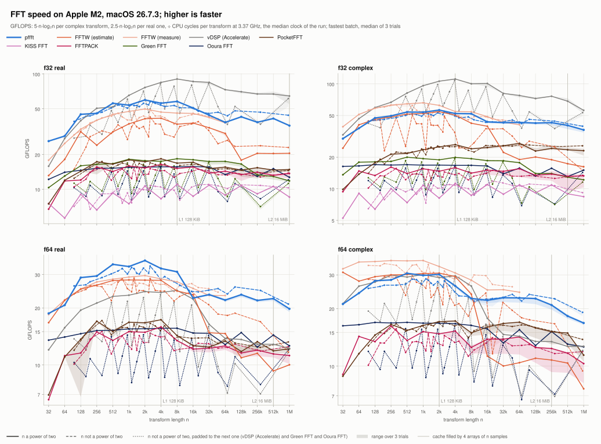
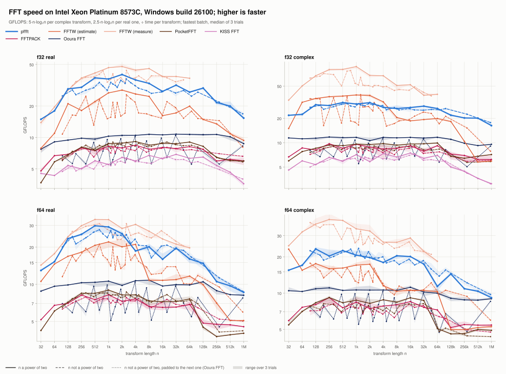

# pffft benchmark results

Measured with [bench_fft](../benchmarks/README.md) in November 2026: pffft
(commit 2e9db19) against the FFT libraries it is usually compared with, on
nine machines, and against pffft 1.1.0, which is as fast as Julien
Pommier's original, on six. Every chart has a panel per precision (f32,
f64) and transform kind (real, complex). The charts per machine cover 44
lengths from 32 to 2^20: the powers of two and 28 other lengths with
factors 3 and 5. The comparisons with 1.1.0 cover 26 of them: the powers
of two and 10 others.

## Summary

pffft's speed relative to each library: the geometric mean over the 176
cases of a machine (2 precisions × 2 kinds × 44 lengths) of the other
library's time over pffft's. Above 1, pffft is faster; "-" means the library
is not available there.

| Machine | FFTW (measure) | FFTW (estimate) | vDSP | PocketFFT | KISS FFT | FFTPACK | Green FFT | Ooura's FFT |
|---|---|---|---|---|---|---|---|---|
| Apple M2, macOS | 0.91 | 1.24 | 0.85 | 1.91 | 4.61 | 2.40 | 2.51 | 1.99 |
| iPhone 11 Pro (A13), iOS | 0.98 | 1.32 | 0.98 | 2.04 | 4.71 | 2.28 | 2.72 | 2.16 |
| MediaTek MT6878, Android | 1.15 | 1.45 | - | 2.07 | 4.50 | 2.29 | 2.14 | 1.79 |
| Arm Neoverse N2, Linux | 1.24 | 1.68 | - | 1.90 | 4.80 | 2.76 | 4.47 | 2.23 |
| Microsoft Cobalt 100 (Neoverse N2), Windows | - | - | - | 2.39 | 4.22 | 2.55 | - | 2.09 |
| Intel Xeon 6975P-C, Linux | 0.61 | 0.92 | - | 1.66 | 6.04 | 2.33 | 3.71 | 2.17 |
| Intel Xeon Platinum 8573C, Windows | 0.65 | 1.33 | - | 2.79 | 4.35 | 2.91 | - | 1.86 |
| AMD EPYC 9V45, Linux | 0.70 | 1.37 | - | 1.61 | 6.86 | 2.89 | 4.97 | 2.80 |
| Intel Core i7-8700B, macOS (VM) | 0.84 | 1.43 | 0.72 | 2.21 | 4.71 | 2.42 | 2.84 | 1.55 |

KISS FFT and Green FFT are measured in single precision only. vDSP, Green
FFT and Ooura's FFT do only powers of two, and `FFTW_MEASURE` runs only up
to n = 65536, so their means are over those cases (on the Cobalt 100,
Ooura's FFT has no single-precision real n = 32).

- **Portable libraries.** pffft was faster than PocketFFT, KISS FFT,
  FFTPACK, Green FFT and Ooura's FFT in 4705 of the 4759 cases.
  - *Ooura's FFT*, 29 of the 54 exceptions: double precision out of cache,
    from n = 131072 (from 262144 on the Core i7, only 2^20 on the M2, the
    iPhone and the EPYC 9V45; also single precision complex 2^20 on the
    Core i7), where pffft was up to 77% slower (real 2^20 on the Core i7),
    and double and single precision real n = 32 on the Core i7 (5.3% and
    2.5%). Ooura's FFT works in
    place, so out of cache it moves less data than pffft's ordered
    transform out of place.
  - *PocketFFT*: 20 cases on the AMD EPYC 9V45, all complex: 17 single
    precision lengths that are not powers of two, from 960 to 100000, where
    pffft was up to 12.6% slower, and 3 double precision ones, up to 1.9%.
    4 more on the Xeon 6975P-C, complex transforms out of cache (n of 72000
    and more, up to 8.8%), where at 2^20 FFTPACK was also faster.
- **FFTW** plans a transform in one of several modes; two are measured here.
  `FFTW_ESTIMATE` plans at once, as pffft and the other libraries do.
  `FFTW_MEASURE` times candidate algorithms on the machine and keeps the
  fastest, which takes up to a few seconds per length. The benchmark leaves
  that planning time out, so the comparison favours `FFTW_MEASURE`: in an
  application its cost pays off only over many transforms of one length.
  - *Real transforms.* pffft was faster than `FFTW_ESTIMATE` on every
    machine (geometric means from 1.14 on the Xeon 6975P-C to 1.81 on the
    Neoverse N2), and faster than `FFTW_MEASURE` on every arm64 machine
    (1.06 on the M2, 1.15 on the iPhone, 1.33 on the MediaTek phone and
    1.44 on the Neoverse N2).
  - *Complex transforms.* pffft was faster than `FFTW_ESTIMATE` everywhere
    but on the Xeon 6975P-C (1.07 to 1.56; 0.75 there). `FFTW_MEASURE` was
    faster on Apple's chips (pffft 0.78 and 0.83), level with pffft on the
    MediaTek phone (1.00) and slower on the Neoverse N2 (1.06).
  - *x86.* `FFTW_MEASURE` was faster on the x86 machines (pffft 0.61 to
    0.84 over all its cases): FFTW has AVX2 and AVX-512 code, while pffft's
    single precision uses 4-wide SSE there (its double precision uses AVX).
- **vDSP**, Apple's FFT, was faster in single precision. On Apple's chips it
  hands single-precision FFTs to the AMX matrix unit, a coprocessor that
  the cores of a cluster share: one thread at a time benefits, while
  pffft's NEON code runs on every core. While AMX works, the chip can lower
  its clock: on the M2 by 7.7% for every single-precision FFT from n = 256
  (complex) or 512 (real) up, on the iPhone 11 Pro by up to 25%, for real
  FFTs of n = 512 to 4096. bench_fft charges vDSP for that (see
  [How it was measured](#how-it-was-measured)). In double precision, where
  vDSP lowered the clock no more than the other libraries, pffft was faster
  on Apple's chips (geometric means 1.03 to 1.38 per kind) and slower on
  the Intel Mac (0.90 real, 0.69 complex).

## Performance improvements since Pommier's pffft


pffft 1.1.0 (here commit c14802c) predates the performance work of this
fork. Its single-precision FFT is Julien Pommier's original code, so its
speed is the speed of Pommier's pffft (which has no double precision). Since
then pffft has gained, among others, fused multiply-adds (NEON and x86 FMA),
NEON double precision with native intrinsics instead of an emulation, faster
NEON transposes, fast paths in the radix-3 and radix-4 real butterflies,
code layout that keeps the radix-3 and radix-5 real kernels out of line,
one pass fewer for the real and complex lengths whose n/4 has an odd power
of two (a radix-8 or radix-6 last pass in place of the radix-2 one), complex
butterflies that get the direction of the transform as a constant, and, on
x86, prefetching of the output of the passes out of L1.

Both versions run in one process and take turns, batch by batch
(benchmarks/compare.py). Averaged over the lengths, the current pffft was 21
to 22% faster below n = 4096 (22.3% on the M2, 21.9% on the iPhone, 21.2%
on the MediaTek phone) and 10.5 to 13% faster from 4096 up (11.0%, 12.8%
and 10.5%), up to 69% at single lengths (single-precision real n = 32 on
the M2). In cache (n up to 16384) it was faster at every length, by 2% at
least; out of cache the gain shrinks, and on the MediaTek phone three
double-precision real lengths from 2^16 up are within the noise (1.2%
slower at most).


On x86 the work above for NEON doesn't apply; what does is FMA (where the
build targets AVX2 or newer), the radix-3 and radix-4 fast paths, the code
layout, the pass fewer, the constant direction and the output prefetching.
On the Intel machines pffft was faster than 1.1.0 at every length but three
complex ones of 2^20 (0.2 to 0.5% slower, within the noise): below
n = 4096 by 19.8% on the Xeon 6975P-C (Linux, gcc) and 22.9% on the Core
i7-8700B (macOS, Clang), from 4096 up by 18.8% and 16.9%. The largest gains
are at real n = 32 (in single precision 41% on the Xeon and 75% on the
Core i7) and out of L1 in double precision (real n = 32768 53% and
n = 8192 50% on the Xeon, n = 8192 52% on the Core i7).

The AMD EPYC 7763 (Windows, MSVC) is the case the README warns about: MSVC
cannot tell AMD from Intel, so the default build prefetches there too, and
Zen does not gain from it. pffft was 20.7% faster than 1.1.0 below n = 4096
and 2.8% from 4096 up. It was slower at 23 lengths, by up to 5.8%, all of
them lengths whose passes this fork has not changed beyond the
prefetching: 22 from n = 4096 up, where it prefetches (double-precision
real n = 15360 and 16384 and single-precision real 2^20 the most), and
double-precision complex n = 64 (5.0%), too small for the prefetching,
where it is code layout. With `PFFFT_PREFETCH_DIST=0`, as the README
recommends for AMD CPUs, an earlier version of this code (the one of pull
request #129) was 8.6% and 4.8% faster than 1.1.0 there, against 6.4% and
0.1% slower for its default build in the same run.

## Machines

How to read the charts: each shows one machine, with the speed in GFLOPS on
a log scale (higher is faster) over the transform length n.

- **Solid lines** are the powers of two.
- **Dashed lines** are the other lengths, which the library transforms as
  they are.
- **Dotted lines** are the other lengths for a library that only does powers
  of two (vDSP, Green FFT, Ooura's FFT): the flops of n in the time of the
  next power of two, as if the input were padded with zeros to it.
- **Bands** around a line show the range over the 3 trials.
- **Grey vertical lines** mark the lengths at which four arrays of n
  samples, about the working set of a transform, fill the L1 and L2 caches
  (and L3, where the system reports one).

Where cycles were counted, the subtitle gives the clock at which they were
converted to time.

### Apple M2, macOS


### iPhone 11 Pro (A13), iOS


### MediaTek MT6878, Android


### Arm Neoverse N2, Linux (GitHub runner)


### Microsoft Cobalt 100, Windows (GitHub runner)
FFTW is left out: its CMake build, the one Windows can use, has no NEON.
Green FFT crashes on Windows.


### Intel Xeon 6975P-C, Linux (GitHub runner)


### Intel Xeon Platinum 8573C, Windows (GitHub runner)
FFTW is built with its CMake build here, with AVX2: that build has no
AVX-512 code, while pffft and the other libraries were built with
/arch:AVX512.



### AMD EPYC 9V45, Linux (GitHub runner)
This runner exposes no cycle counter, so the chart is in measured time.


### Intel Core i7-8700B, macOS (GitHub runner, VM)


## How it was measured

- **Speed** is in GFLOPS, counting 5·n·log2(n) flops per complex transform
  and 2.5·n·log2(n) per real one (benchFFT's convention), for one transform:
  half a forward and backward pair, out of place, ordered output
  (pffft_transform_ordered). It is the fastest of many short batches,
  median of 3 trials.
- **Time.** Where the system lets a program count its CPU cycles (the M2,
  the iPhone, the MediaTek phone, the Neoverse N2 and the Xeon 6975P-C), a
  transform's time is its cycles at the median clock of the run, which
  keeps the clock's noise out. Elsewhere (Windows, macOS virtual machines,
  the EPYC 9V45) it is the measured time.
- **Clock.** Cycles are fair only if every library runs at the same clock.
  bench_fft compares the clock of each batch with that of the neighbouring
  batches of the other libraries; a library that lowers the clock by more
  than 2%, such as vDSP through AMX, is charged for the cycles it costs the
  others: its count is divided by the ratio of the clocks.
  [benchmarks/README.md](../benchmarks/README.md) explains the method and
  its limits.
- **Builds.** Every library was compiled from source with the same flags,
  the best for the CPU: -march=native with Clang and GCC (the M2, the Linux
  and macOS runners), /arch:AVX512 with MSVC on the Xeon Platinum 8573C
  (/arch:AVX2 on the EPYC 7763 of the comparison with 1.1.0), MSVC's default
  on the Cobalt 100. The phones were built with their toolchain's defaults
  (NEON). FFTW 3.3.10 was built with its SIMD code (NEON, AVX, AVX2, AVX-512
  where the CPU has it), except on Windows, where its CMake build has AVX2
  at most and no NEON (hence no FFTW on the Cobalt 100). vDSP is the
  system's Accelerate.
- **Versions.** pffft is commit 2e9db19. It was measured as commit 9381f86,
  the same code on master before pull request #132, which changed none of
  the files these builds compile, and on GitHub's runners as commit
  c53a991, which adds a scratch input to the benchmark workflow (the
  headers of the comparison CSVs name it). 1.1.0 is commit c14802c. The
  phones and the M2 ran the benchmark locally; the other machines are
  GitHub-hosted runners (shared virtual machines), measured by
  .github/workflows/bench.yml, the comparisons on x86 with its `compare`
  input set to c14802c and the measured commit. GitHub's ubuntu-26.04 and
  windows-2025 labels land on several Intel and AMD CPUs, some without a
  cycle counter; their runs were repeated until they ran on the CPUs
  above, the Xeon 6975P-C with a cycle counter.

To repeat a measurement:

```sh
python3 benchmarks/run.py --fftw -o local.csv            # this computer
python3 benchmarks/compare.py c14802c master -o cmp.csv  # two revisions
uv run --with matplotlib python3 benchmarks/plot.py local.csv -o local.png
```
